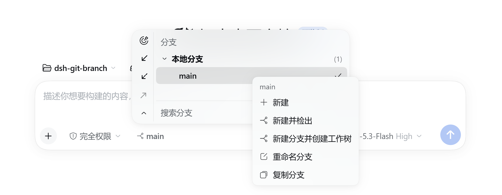
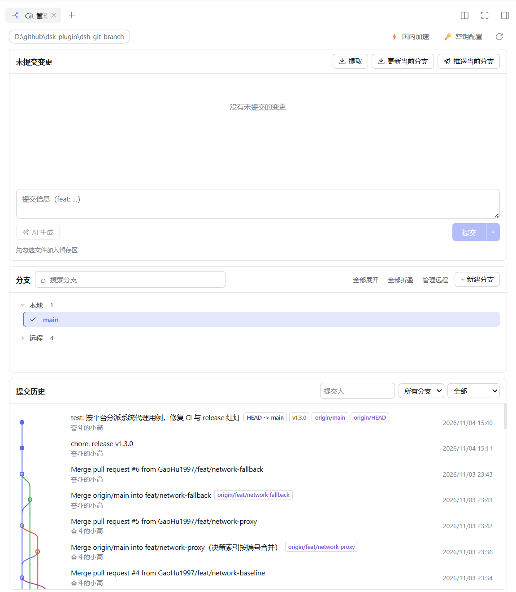

# dsh-git-branch

[](https://www.npmjs.com/package/dsh-git-branch-manage)
[](./LICENSE)

DSH（DeepSeek Harness）插件：在对话框里提供 git 分支管理以及代码推送、拉取功能。

提供 git 分支与 worktree 管理：输入框工具栏显示当前分支、可原地切换；支持 IDEA 风格分支选择器、远程分支检出、右键操作菜单（新建/重命名/删除/复制）、推送与更新当前分支，以及把分支隔离到独立 worktree 工作区，并管理其创建与删除。

> npm 包名 [`dsh-git-branch-manage`](https://www.npmjs.com/package/dsh-git-branch-manage)，插件 id `dsh-git-branch`，展示名「git 分支管理」（[包名由来见决策 0003](./docs/decisions/0003-rename-package-to-dsh-git-branch-manage.md)）。

## 目录

- [截图](#截图)
- [功能](#功能)
  - [输入框分支工具栏](#输入框分支工具栏)
  - [Git 管理面板（侧边栏）](#git-管理面板侧边栏)
  - [worktree 隔离工作区](#worktree-隔离工作区)
  - [凭据管理](#凭据管理)
  - [远程管理](#远程管理)
  - [网络可靠性](#网络可靠性)
  - [AI 工具](#ai-工具)
- [安装](#安装)
- [配置](#配置)
- [开发](#开发)
- [文档](#文档)
- [许可](#许可)

## 截图

输入框工具栏的分支 chip 与 IDEA 风格分支选择器（右键菜单含新建、新建并检出、新建分支并创建工作树、重命名、复制）：



侧边栏 Git 管理面板（未提交变更 / 分支 / 提交历史图）：



## 功能

### 输入框分支工具栏

- 当前分支 chip 常驻输入框工具栏；会话目录不是 git 仓库时不渲染。
- IDEA 风格分支选择器：**本地分支 / 远程分支 / 工作树** 分组、分支搜索框、全部展开/折叠、一键定位当前分支。
- 分支行右键菜单：检出、跳转到该分支的工作树、新建、新建并检出、新建分支并创建工作树、重命名、删除、复制分支名 / 复制路径。
- 一键 **fetch**、**更新当前分支**、**推送当前分支**（无可推送提交时禁用，[决策 0009](./docs/decisions/0009-disable-empty-push.md)）。
- 原地 `git switch`：失败时 toast 透出 git 原始错误并回显原分支；已被其他 worktree 检出的分支在菜单里预防性禁用。
- 会话启动后目录固定，切换只作用于当前会话自己的检出，不动主 checkout。

### Git 管理面板（侧边栏）

注册为右侧边栏的一个页签（通过可选插件 `dsh-better-sidebar` 发布的 `ctx.betterSidebar` 注册，[决策 0013](./docs/decisions/0013-git-history-panel.md)）。**该插件是可选的**：未安装时本页签不出现，输入框 chip 与设置卡照常工作。

- **未提交变更**：勾选文件加入暂存区、提交信息输入、**AI 生成**提交信息、提交；顶部另有 提取 / 更新当前分支 / 推送当前分支。
- **分支**：搜索框、本地/远程分组树、全部展开/折叠、新建分支、管理远程。
- **提交历史**：提交连线图（[决策 0019](./docs/decisions/0019-git-history-graph-panel.md)）、按提交人 / 分支 / 范围筛选、右键推送标签（[决策 0020](./docs/decisions/0020-push-tag-action.md)）。
- 顶栏：仓库路径 pill、刷新、**国内加速** 配置浮层、**密钥配置** 入口。

### worktree 隔离工作区

- 勾选 worktree 后基于所选分支创建独立 worktree 并**注册为 DSH workspace、直接开始会话**；同名 worktree 已存在则幂等复用（[决策 0015](./docs/decisions/0015-branch-context-menu-and-switch-target.md)）。
- 目录规划 `<rootDir>/<仓库名>/<规范化分支名>`：`/` → `-`，剔除 Windows 非法字符与尾随点/空格，避免多仓库同名分支冲突。
- 创建前可选 fetch 所有远程（失败不阻断创建）；创建后可选惰性清理陈旧 worktree，`keepWorktrees` 控制保留上限。
- 创建后可拷贝配置文件（`postCreateCopyFiles`）；存在 `.worktreeinclude` 时不拷贝。
- **worktree 管理对话框**：全量列表、脏工作区检查、删除 / 清除目录、孤儿（已删目录的残留注册）识别；目录内仍有 RUNNING 会话时拒绝删除，删除会连同会话归档与 workspace 注册一起清理，被检出的分支本身保留（[决策 0014](./docs/decisions/0014-panel-card-height-and-branch-collapse.md)）。

### 凭据管理

- 面板里存一次，**直接读写本机 `~/.git-credentials`**（权限 0600），并经 `~/.gitconfig` 的 URL 作用域 `include` 装上 git 内置 `store` helper（[决策 0037](./docs/decisions/0037-local-git-credentials-backend.md)）——因此面板、任何 shell 里的 `git push/pull`、AI 工具走的是同一账号。
- 启动时**自动从本机导入**：按用户 gitconfig 声明过的域名逐个 `git credential fill` 探测（串行 + 20 秒超时），`gh`、GCM、`store` 里的账号一次接管（[决策 0038](./docs/decisions/0038-import-machine-credentials.md)）；面板另有手动「从本机导入」。
- 表单支持**浏览器登录**与令牌创建入口（[决策 0024](./docs/decisions/0024-credentials-browser-sign-in.md)）。
- 文件里不属于本插件的行（注释、`ssh://` 等）原样保留，**卸载插件后凭据仍属于用户**；未存域名 fail-fast（`GIT_TERMINAL_PROMPT=0`），不弹凭据对话框。
- 面板元数据（`method` / `updatedAt`）另存不含 secret 的旁文件。

### 远程管理

面板内管理仓库的多个远程地址（新增 / 编辑 / 删除，[决策 0022](./docs/decisions/0022-remote-address-management.md)）。

### 网络可靠性

面向大陆网络下 GitHub 直连不稳定的三层处理（[设计文档](./docs/design/network-reliability.md)）：

- **国内加速**：读操作（fetch / update）把 `https://github.com/` 重写为「加速前缀 + 完整 URL」（默认前缀 `https://gh-proxy.com/`，[决策 0040](./docs/decisions/0040-accelerate-complete-github-url.md)）；**推送永不走镜像**，镜像读失败自动回直连再走备用链（[决策 0044](./docs/decisions/0044-mirror-as-read-accelerator-and-ssh-hint.md)）。
- **显式代理**：`networkProxy` 支持 `http(s)://` / `socks5://`，另可只读探测系统代理给出建议。
- **IP 优选备用通道**：直连发生可重试故障时，对 GitHub 地址做运行时 DoH 查询并用真实 git 请求竞速选路（[决策 0042](./docs/decisions/0042-ip-optimized-fallback-channel.md)）。
- **分级预算与核验**：按探测 / 读取 / 写入 / 超时核验分别设预算；推送前探测远端，推送超时后核验远端 ref，按失败类型给出建议（[决策 0041](./docs/decisions/0041-network-budgets-and-push-verification.md)）。
- 面板「**检测网络**」诊断入口；SSH 远端不做无效的 HTTP 通道探测，错误信息改为提示 HTTPS 方案。

### AI 工具

插件向模型注册两个只读优先的工具（[决策 0029](./docs/decisions/0029-ai-network-credentials-tool.md)）：

| 工具 | 作用 | 边界 |
| --- | --- | --- |
| `git_credentials` | 列出已配置的 git 主机与掩码后的凭据 | 只读；`includeSecret` 才返回明文 |
| `git_network` | 用本机凭据执行一条 git 网络命令 | 子命令白名单 `fetch` / `pull` / `push` / `ls-remote`；`repoPath` 必须绝对路径；禁止 `--force`、`--delete`、`-c`、`--upload-pack` / `--receive-pack` 等 |

凭据经 git 原生 `credential-store` 通道生效，**不进入命令行参数、不进入对话上下文**。

## 安装

前置条件：

- 已安装 DSH（DeepSeek Harness）；
- `git` 在 PATH 中可用；
- Node.js `>= 22.19`（插件运行环境要求，见 `package.json` 的 `engines`）。

安装方式（任选其一）：

1. DSH 的插件管理（Plugins）页签里搜索并安装 npm 包 **`dsh-git-branch-manage`**；
2. CLI：`dsh plugin add dsh-git-branch-manage`（见 [notes/FIRST-SPEC.md](./notes/FIRST-SPEC.md)）。

peer 依赖（`@deepseek-ai/cordis`、`@deepseek-ai/dsh-settings`、`@deepseek-ai/dsh-host-webserver`、`@deepseek-ai/schemastery`）由 DSH 宿主提供，无需单独安装。侧边栏 Git 面板需要额外安装可选插件 `dsh-better-sidebar`。

## 配置

在 DSH 设置 → 插件 → **git 分支管理**（Host 条目 `dsh-git-branch`）的配置卡中修改；所有字段即时生效并写回 profile 的 `cordis.patch.yml`。未知配置键会被直接拒绝（防止拼写错误被默认值掩盖）。

| 配置项 | 默认值 | 说明 |
| --- | --- | --- |
| `rootDir` | `$DSH_HOME/gitworktree`（即 `~/.dsh/gitworktree`） | worktree 存放根路径；必须是绝对路径 |
| `groupSidebar` | `true` | 侧边栏把同一仓库的 worktree 归入一个分组 |
| `fetchBeforeCreate` | `false` | 创建 worktree 前 fetch 所有远程（失败不阻断创建） |
| `autoPruneWorktrees` | `false` | 创建后惰性清理陈旧 worktree |
| `keepWorktrees` | `30` | 清理保留上限，整数且 `>= 1`，只统计有效的 git worktree |
| `postCreateCopyFiles` | `[]` | 无 `.worktreeinclude` 时，创建后拷贝的配置文件列表 |
| `cnAccelerate` | `false` | 国内加速：仅重写 fetch / update 读操作，**push 永不重写** |
| `cnAccelerateUrl` | `https://gh-proxy.com/` | 加速前缀，须为不含空白的 http(s) URL |
| `networkProxy` | 空 | 显式代理，`http(s)` / `socks5` URL，不允许携带凭据与路径 |

## 开发

```bash
pnpm install            # 需要 pnpm 11.8.0（packageManager 字段）
pnpm run build          # 服务端：tsc -p tsconfig.json → lib/
pnpm run build:client   # 客户端：tsdown → lib/client.js
pnpm run build:all      # 上面两步
pnpm run watch:client   # 客户端增量构建
pnpm run test           # vitest run
pnpm run typecheck      # tsc -p tsconfig.client.json --noEmit
```

`prepublishOnly` 会依次执行 `typecheck` → `test` → `build:all`。

目录速览：

| 路径 | 内容 |
| --- | --- |
| `src/index.ts` | host 半边：设置 schema 与校验、HTTP 路由挂载、AI 工具注册 |
| `src/client/` | 浏览器半边：分支 chip、Git 面板、设置卡、worktree 对话框 |
| `src/wire.ts` | 双端共享的路由常量与请求/响应类型（零依赖契约） |
| `src/git.ts` | git 执行器：参数拼装 + porcelain 解析，exec 注入式 seam |
| `src/credential-service.ts` | 凭据唯一入口（store / include / shell 环境） |
| `src/network*.ts` | 网络通道：加速、代理、IP 优选、探测与预算 |
| `tests/*.spec.ts` | vitest 用例（37 个 spec），含真实 git 端到端回归 `shell-bridge-e2e` |
| `locale/*.json` | 插件展示元数据（标题/描述）的中英文词典；界面文案在 `src/client/locales.ts` |
| `docs/decisions/` | 决策记录（ADR），非平凡变更须随同一提交更新 |
| `.github/workflows/` | CI 与 tag 触发的 npm 发布（[决策 0010](./docs/decisions/0010-github-actions-ci-and-npm-release.md)） |

## 文档

- [CHANGELOG.md](./CHANGELOG.md) — 版本变更记录（语义化版本）
- [docs/decisions/README.md](./docs/decisions/README.md) — 决策记录索引与规范
- [docs/design/network-reliability.md](./docs/design/network-reliability.md)、[docs/design/cn-accelerate.md](./docs/design/cn-accelerate.md) — 网络可靠性与国内加速设计
- [notes/FIRST-SPEC.md](./notes/FIRST-SPEC.md)、[notes/GIT-PANEL-SPEC.md](./notes/GIT-PANEL-SPEC.md) — 初始需求与面板规格

## 许可

[MIT](./LICENSE) © GaoHu1997
